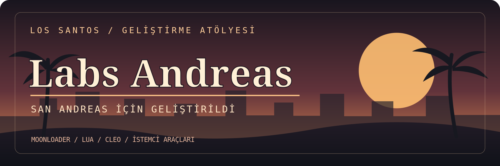

<div align="center">



<br>

**SAN ANDREAS YAŞAMAYA DEVAM EDİYOR.**

*Eski sokaklar. Yeni fikirler.*

[](https://www.rockstargames.com/games/sanandreas)
[](https://www.sa-mp.mp/)
[](https://www.lua.org/)
[](https://github.com/orgs/LabsAndreas/repositories)

[**HAKKIMIZDA**](#-labs-andreas-nedir) · [**ÇALIŞMA ALANLARI**](#-neler-geliştiriyoruz) · [**PROJELER**](#-proje-merkezi) · [**KURULUM**](#-kurulum-öncesi) · [**KATKI**](#-katkı-ve-geri-bildirim)

</div>

---

## 🌴 Labs Andreas nedir?

**Labs Andreas**, Grand Theft Auto: San Andreas'ın çok oyunculu dünyası için **istemci taraflı scriptler, yardımcı araçlar ve modifikasyonlar** geliştirmeye odaklanan bağımsız bir projedir.

Hedefimiz büyük vaatler vermek değil; oyuncuların gerçekten işine yarayan, ne yaptığı anlaşılabilen ve kurulumu mümkün olduğunca sade tutulan araçlar üretmek.

SA-MP'nin yıllardır ayakta kalmasını sağlayan topluluğun bir parçasıyız. Bu yüzden her projede **uyumluluk, şeffaflık ve oyun deneyimine saygı** önceliğimiz.

> **GÖREV 01 — ŞEHRİ YAŞAT**  
> San Andreas'ın hikâyesi bitmedi. Biz de yeni fikirler üretmeye devam ediyoruz.

## 🛠️ Neler geliştiriyoruz?

| Alan | İçerik |
|:--|:--|
| **Lua / MoonLoader** | İstemci taraflı scriptler, oyun içi yardımcı araçlar ve arayüz geliştirmeleri |
| **CLEO / GTA SA** | Klasik oyun altyapısına yönelik küçük ve amaca odaklı modifikasyonlar |
| **Performans / Kararlılık** | Ölçüm, hata tespiti, uyumluluk incelemeleri ve test edilmiş iyileştirmeler |
| **Geliştirici araçları** | Örnek kodlar, teknik notlar, kurulum ve sorun giderme dokümanları |

**Öncelikli ortam:** GTA San Andreas PC · SA-MP 0.3.DL · Lua · MoonLoader · CLEO  
**Uyumluluk notu:** Her aracın desteklediği sürümler kendi proje sayfasında ayrıca belirtilir.

## 🗺️ Proje merkezi

Projelerimizi ayrı depolarda yayımlamayı hedefliyoruz. Böylece her aracın **kaynak kodu, kurulumu, sürüm geçmişi ve bilinen sorunları** kendi sayfasında bulunabilir.

| Bölüm | Bağlantı |
|:--|:--|
| **Tüm açık projeler** | [Labs Andreas depoları](https://github.com/orgs/LabsAndreas/repositories) |
| **İndirilebilir sürümler** | İlgili projenin **Releases** bölümünü kontrol edin |
| **Hata bildirimleri / öneriler** | İlgili projenin **Issues** bölümünü kullanın |

> **Not:** Burada henüz yayımlanmamış bir aracı yayımlanmış gibi göstermiyoruz. Yeni projeler hazırlandıkça kendi depolarında yer alacak.

## 📟 Geliştirme yaklaşımımız

```text
╔══════════════════════════════════════════════╗
║       LABS ANDREAS / GELİŞTİRME PROTOKOLÜ     ║
╠══════════════════════════════════════════════╣
║  01  ÖNCE İNCELE, SONRA DEĞİŞTİR.            ║
║  02  KÜÇÜK AMA FAYDALI ARAÇLAR ÜRET.          ║
║  03  TEST ETMEDEN YAYIMLAMA.                  ║
║  04  GEREKSİNİMLERİ VE SINIRLARI BELİRT.      ║
║  05  ORİJİNAL GELİŞTİRİCİLERE EMEK VER.       ║
║  06  SUNUCU KURALLARINA SAYGI GÖSTER.         ║
╚══════════════════════════════════════════════╝
```

- **Açıklık:** Bir scriptin ne yaptığı, neyi değiştirdiği ve hangi bağımlılıklara ihtiyaç duyduğu anlaşılır olmalı.
- **Geri alınabilirlik:** Mümkün olduğunda oyunun temel dosyalarını gereksiz yere değiştirmeyen, kolay kaldırılabilen çözümler tercih edilir.
- **Gerçekçi iddialar:** Her sistemde kesin FPS artışı, sıfır çökme veya tüm sunucularla sorunsuz çalışma garantisi verilmez.
- **Emeğe saygı:** Kullanılan üçüncü taraf çalışmaların lisanslarına ve sahiplerine dikkat edilir.
- **Adil kullanım:** İstemci araçlarının izin durumu sunucudan sunucuya değişebilir. Kullanmadan önce sunucu kurallarını kontrol edin.

## 🧰 Kurulum öncesi

<details>
<summary><b>Kurulum kontrol listesini aç</b></summary>

1. İndirmek istediğiniz projenin `README.md` dosyasını ve varsa sürüm notlarını okuyun.
2. GTA San Andreas, SA-MP, MoonLoader ve diğer bileşenlerin **o araçla** uyumlu sürümlerini doğrulayın.
3. Üzerine yazılacak veya değiştirilecek dosyaların yedeğini alın.
4. Mümkün olduğunda dosyaları doğrudan ilgili GitHub deposunun **Releases** bölümünden indirin.
5. Kullanacağınız sunucunun istemci modifikasyonlarına ilişkin kurallarını kontrol edin.
6. Sorun yaşarsanız hata kayıtlarını ve kullandığınız sürümleri not edin.

</details>

## 🤝 Katkı ve geri bildirim

Bir hata mı buldunuz, yeni bir araç fikriniz mi var? İlgili projenin **Issues** bölümünde bildirim açabilirsiniz. Kod düzeltmesi önermek isteyenler, uygun projelerde **Pull Request** gönderebilir.

Hata bildirirken aşağıdaki bilgileri eklemek çözümü kolaylaştırır:

```text
Proje ve sürüm:
GTA San Andreas sürümü:
SA-MP sürümü:
MoonLoader sürümü (varsa):
Sorunu yeniden oluşturma adımları:
Beklenen sonuç:
Gerçekte olan:
Hata kaydı / ekran görüntüsü (kişisel verileri silin):
```

---

<div align="center">

### 🌆 BU ŞEHİR KOLAY KOLAY UYUMAZ.

**LABS ANDREAS**  
`GELİŞTİR` · `TEST ET` · `İYİLEŞTİR` · `PAYLAŞ`

<sub>Labs Andreas bağımsız bir hayran geliştirme projesidir. Rockstar Games, Take-Two Interactive, SA-MP veya open.mp ile resmî bağlantısı ya da onayı yoktur. İlgili marka adları hak sahiplerine aittir.</sub>

</div>
